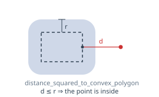
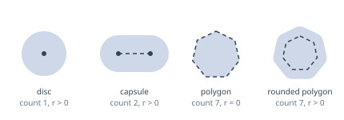
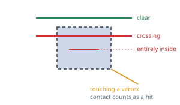
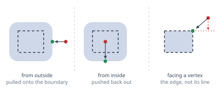
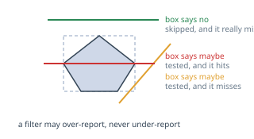
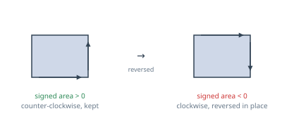
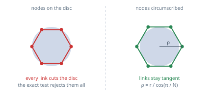
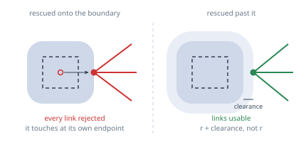

# geometry

Geometric predicates over a convex outline dilated by a radius, as free functions on plain arrays.
Nothing here knows about obstacles, shared memory or nanobind — which is what makes every predicate
testable on its own.

| Function | Answers |
|---|---|
| `distance_squared_to_convex_polygon` | how far is a point from the outline |
| `point_in_rounded_polygon` | is this point inside the obstacle |
| `segment_intersects_rounded_polygon` | does this path segment hit the obstacle |
| `nearest_point_on_rounded_polygon` | where do I put a pose that ended up inside one |
| `aabb_*` | can I skip this obstacle without measuring anything |
| `signed_area_twice`, `is_convex`, `normalize_winding` | is this outline storable, and wound which way |

## One primitive

An obstacle is a convex outline `P` dilated by a radius `r`, so a single question answers all the
others: **how far is the query from `P`?**

Everything else is a comparison against `r²`:

| Question | Answer |
|---|---|
| Is the point inside? | `d² ≤ r²` |
| Does the segment collide? | is *any* edge within `r²` |
| Where is the boundary? | the nearest point on `P`, pushed out by `r` |

Comparing squares means **no square root in any boolean predicate**. The only one left is
`nearest_point_on_rounded_polygon`, which has to produce an actual point, and it runs a handful of
times per replanning rather than once per graph edge.

## No degenerate cases

`PolygonView` carries a vertex count, and one, two or sixteen vertices are all valid convex sets:

So a disc is not a special case, it is a one-vertex outline. Guarding the predicates with
`if (count < 3) return false;`, as an earlier version did, would let **every disc through**.

## Contact is a collision

Every predicate includes the boundary — `d² ≤ r² + EPSILON` — and there is no way to ask for
anything else. One convention, in the safe direction: a false positive costs a detour, a false
negative costs a collision.

The alternative would be a strict variant, and `dj` does carry one: `is_strictly_in_polygon` is its
most-called predicate, in nine places of its graph builder. It needs it because it places its graph
nodes at exactly `oversize_distance / cos(Δθ/2)` — **tangent, with no clearance** — so an inclusive
test would reject every one of them.

That is a remedy for a problem we do not have, and it would make correctness rest on a floating
point comparison at exactly `d² == r²`, reached through a `cos` and a `sin`. A real clearance is
sturdier than the sign of an epsilon, which is why the invariant below is a contract rather than a
convenience.

## Segments

`segment_intersects_convex_polygon` is a separating axis test: two convex sets are disjoint if and
only if some direction exists along which their projections do not overlap, and for a polygon
against a segment it is enough to try the polygon edge normals plus the one normal of the segment.
Nothing in it divides, which matters on the Cortex-A72 where a double division costs 15 to 30
cycles against 4 for a pipelined multiply.

The second case is the reason it is a separating axis test and not an edge walk. A segment lying
entirely inside crosses **no edge**, so walking the edges reports it as clear and hands back a path
straight through the obstacle. No axis separates it, so this one sees it.

`segment_intersects_rounded_polygon` does not go through the primitive: it only needs to know
whether *one* edge comes within the radius, not which one is nearest, so it returns on the first.
That is the function called from the O(V²·N) loop of the graph builder, where the point test is
only called O(V·N) times.

Below it sit `distance_squared_to_segment` (projection clamped to the segment, and a zero-length
segment measured as a point), `segments_intersect` and `distance_squared_between_segments`.

## Nearest point

Three things this gets right, and the previous library did not:

- **from inside**, the result is pushed *out*. That is the only caller there is — rescuing a start
  pose that ended up inside an obstacle. Returning the nearest vertex, as before, hands back a
  point still inside for anything but a very flat obstacle;
- **facing a vertex**, the projection is clamped to each edge, so the result lands on the vertex.
  Projecting onto the supporting lines instead — the dashed arrow — returns a point off the outline
  entirely;
- **at the centre of a disc** there is no direction to read, so it falls back to the outward normal
  of the closest edge, or to +X for a single vertex.

## Bounding boxes

`aabb_overlaps_segment` compares the obstacle box against the **bounding box of the segment**, not
against the segment itself: four comparisons, no multiplication, and deliberately loose. A filter
does not have to decide, it has to be conservative and free. The only property that matters is the
one it does guarantee — it can wrongly answer maybe, never wrongly answer no.

## Outline invariants

Every predicate above reads the sign of a cross product as inside or outside, which only holds for
one winding. `normalize_winding` fixes it once, when the outline is stored, so the queries never
have to care. It is also a precondition of any offset: an outline wound the wrong way inflates
inward.

`is_convex` walks the outline once and asks, at each vertex, which way the two edges meeting there
turn. It compares the **squared sine** of the turn rather than the cross product itself, so the
threshold does not grow with the obstacle and no square root is needed. Flat vertices pass; a
self-crossing outline slips through, since it turns the same way throughout while looping twice.
The figure and the full argument are in
[`obstacles_new/README.md`](../obstacles_new/README.md).

## What is never approximated

The predicates use the **exact** shape. A disc is one vertex and a radius, and asking whether a
point is inside it is one squared distance against `r²` — there is no polygon anywhere in this
library.

Sampling happens in one place only, and it is not a predicate: generating the candidate nodes of
the visibility graph. The two have to agree, and that agreement has a condition.

Put the nodes **on** the disc and the chord between two neighbours dips inside it. The predicate is
exact, so it rejects every link that follows the obstacle, and the graph breaks. The nodes must sit
on the **circumscribed** polygon, `ρ = r / cos(π/N)`, which is what makes the chords tangent.

Tangent is exact, so the margin is what keeps it off the floating-point boundary. With the current
defaults — `obstacle_bb_vertices` = 6, a 150 mm obstacle, and a margin of
`obstacle_bb_margin · robot_length / 2` = 28.9 mm (`planner.py:555`) — the nodes land at
`150 / cos(30°) + 28.9 = 202` mm, and the closest approach of a chord is `202 · cos(30°) = 175` mm.
The links clear the obstacle by 25 mm, not by an epsilon.

The error only ever goes one way. Nodes too far out means a path a little longer than necessary;
an exact predicate means no false negative. Discretising can cost a detour, never a collision.
Raising `N` tightens it: 15 % of overshoot at `N = 6`, 3.5 % at `N = 12`.

## The clearance contract

Including the boundary everywhere is only viable under one condition, and it is worth stating as a
contract because it has more than one call site:

> **Any point that becomes a vertex of the visibility graph must sit at a non-zero distance from
> every obstacle's effective shape.**

A vertex placed *exactly* on a boundary is inside it by this library's convention, so it is
discarded — and worse, every link leaving it touches the obstacle at its own endpoint, so every link
is rejected too. Three places produce such vertices, and all three have to add clearance:

| Producer | Must place at | Not at |
|---|---|---|
| sampling around an obstacle | `(r + clearance) / cos(π/N)` | `r / cos(π/N)` |
| rescuing a pose found inside one | `nearest_point_on_rounded_polygon(view, r + clearance, …)` | `…, r, …` |
| an action target chosen by the planner | anything with clearance from `r` | exactly `r` from a centre |

The second one is easy to miss: `nearest_point_on_rounded_polygon` lands **on** the boundary by
construction, which is what it is for. Handing its result straight to the graph, as
`Avoidance.cpp:69-70` does today with `nearest_point`, puts a vertex on the boundary. On `master`
that happens to work because the rescue uses `radius + bounding_box_margin` while the containment
test uses the bare `radius` — the clearance is there by accident. Here it has to be asked for.

None of this is a tuning knob that may be set to zero.

## Two tolerances

`EPSILON = 1e-6` is in mm². Every test is either a cross product of two vectors in millimetres or a
squared distance, so both live in the same unit and one constant covers them. It only ever widens
an acceptance: a false positive costs a detour, a false negative costs a collision.

`COLLINEARITY_EPSILON_SQUARED = 1e-18` is dimensionless — a squared sine, hence independent of the
size of the obstacle.

The geometry itself, and why a Minkowski sum is the right representation, is documented in
[`obstacles_new/README.md`](../obstacles_new/README.md).
