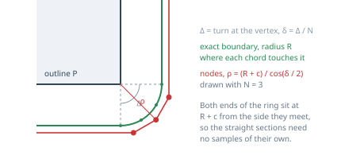

# graph

The visibility graph: nodes sampled around grown obstacles, edges between the pairs that can see
each other. It is the only place in the obstacle stack where a shape is **approximated**, which is
why it is a library of its own.

| Function | Answers |
|---|---|
| `sample_nodes` | where do the graph nodes of this obstacle go |
| `sample_inflated_outline` | what does this obstacle look like, grown by r |
| `Graph::build` | which of those nodes survive, and which pairs see each other |

## Two samplings, not one

An obstacle is `P ⊕ D(r)`, and growing it by the robot radius `ρ` is one addition — see
[`obstacles_new`](../obstacles_new). The boundary of `P ⊕ D(R)`, `R = r + ρ`, is straight sections
offset from the edges of `P` and circular arcs of radius `R` at its vertices. Only the arcs need
sampling, and the two things that sample them want different answers.

**The node ring is circumscribed.** At vertex `i` the exterior arc sweeps the turn angle

    Δᵢ = atan2(cross(u, v), dot(u, v))

of the two edge directions meeting there, in `[0, π)` for a convex outline, and `2π` for a
single-vertex outline — a disc, which has no edge to take a normal from. The arc then takes

    Nᵢ    = max(N, ceil(Δᵢ / MAX_STEP))
    step  = Δᵢ / Nᵢ
    ρᵢ    = (R + clearance) / cos(step / 2)

and places `Nᵢ` points at the mid-angle of each subdivision.

**The displayed outline is on the boundary**, at radius exactly `R`, with both ends of every arc
emitted so the straight sections get drawn instead of cut across. It is display-only: no predicate
reads it, because every predicate uses the exact shape.

The two must not share a resolution. The outline stands for the exact shape, against which the ring
is the visible approximation; drawn alike they would say the same thing, and drawn coarsely the
exact shape would look like an approximation of itself.

## Why circumscribed

Put the nodes **on** the grown boundary and the chord between two neighbours dips inside it. The
predicates are exact, so they reject every link that follows the obstacle — precisely the links a
path needs to get around it — and the graph comes apart. The figure and the disc case are in
[`geometry/README.md`](../geometry/README.md#what-is-never-approximated).

`1 / cos(step / 2)` is how far outside the shape the ring sits, so `MAX_STEP` **is** the worst
overshoot the sampling may produce. At `π / 3` it is 15 %. That bound is also what raises the
requested count where a corner sweeps too wide for it: a disc is never sampled below six points,
each end of a capsule below three, a right angle below two. It keeps the formula total as well,
since `cos(step / 2)` vanishes at `step = π`, but that singularity is not why the bound is where it
is — accuracy is.

**The straight sections are free.** The last point of the arc at vertex `i` and the first of the arc
at vertex `i + 1` both sit at a perpendicular distance `ρᵢ · cos(step / 2) = R + clearance` from the
edge joining them, so the whole segment between them does too. Nothing along a side needs sampling.

## Clearance is not a tuning knob

Every predicate in `geometry` includes its boundary, so a node placed *exactly* on the grown shape
counts as inside it: it is discarded, and every edge leaving it is rejected at its own endpoint.
The full argument is the clearance contract in
[`geometry/README.md`](../geometry/README.md#the-clearance-contract).

`build()` therefore tests each candidate against **every** obstacle, the one it was sampled from
included, rather than against the others only. A node is at `clearance` from its own obstacle by
construction, so the test passes whenever the contract holds — and fails visibly when it does not,
instead of quietly seeding the graph with boundary nodes.

## The walls are a boundary, not an obstacle

Growing a wall shrinks the free region rather than adding a shape, so `build()` takes the table and
shrinks it by `inflation_radius + clearance` itself. Left to the caller that would duplicate the
clearance contract in a second place, and a robot reduced to a point has to stay its own radius off
a wall exactly as it does off an obstacle.

## What it costs

`O(V²·M)` exact segment tests for `V` nodes and `M` obstacles. The bounding box of each grown
obstacle is built once per build, not once per candidate edge, and filters a segment in four
comparisons before the exact test runs — the use `geometry`'s boxes are there for.

On the full 2026 table, eighteen obstacles, the measured range is 0.2 ms at the coarsest settings to
40 ms at the finest, and the node and edge capacities are sized from the same measurements. Both
outputs live in shared memory as plain arrays of `coords_t`, which is two doubles, so another
process draws the graph from a `(n, 2)` view of it without a copy. `cogip-graph-preview` is that
process.
