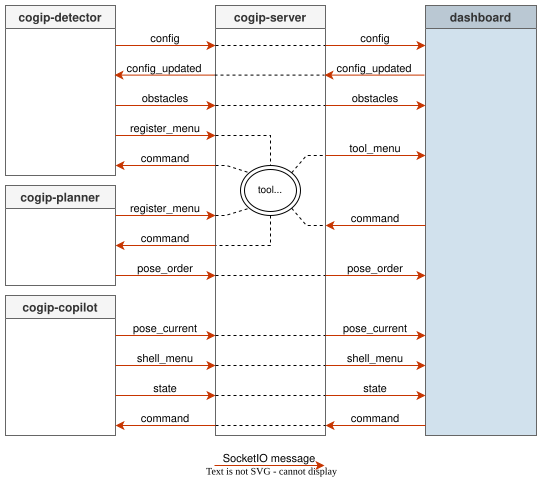

# Dashboard

The `Dashboard` is a web site displayed on the touchscreens
embedded in the robots and on the beacon.

The web server can also be accessed from any devices (PC, smartphones)
connected to the same network.

The web server listen on port `8080 + robot_id`, ie `8080` on beacon and `8081` on robot 1.

## Power Supply

On robot 1 dashboard, the `Power Supply` entry of the root menu opens a popup
displaying the state reported by the power supply board:

- emergency stop button (engaged or released),
- battery and DC supply connection,
- power good flag, voltage, current and power of each rail.

The emergency stop state is also displayed in the footer, next to the starter.
All values are shown as `—` while unknown, for instance when the copilot is not connected.
The 12V rail has no power good signal, so its flag is always shown as `OK`.

## Data Flow

